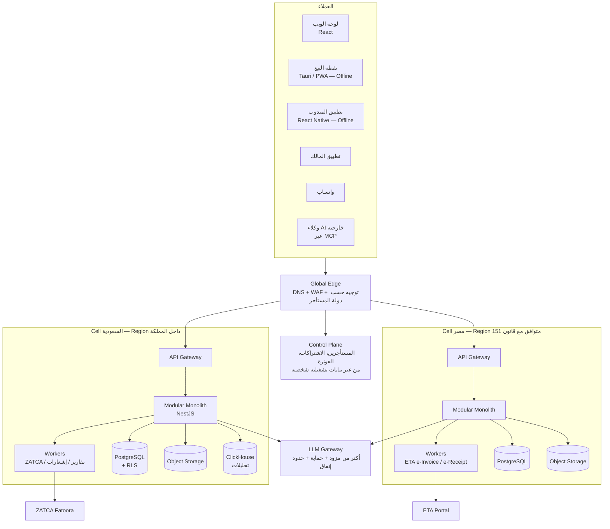
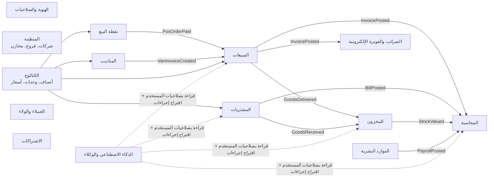
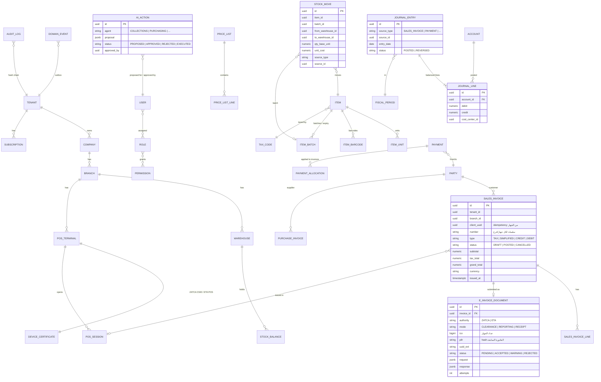

# المرحلة 0: الاستكشاف والتصميم

> ده تسليم المرحلة 0 من [البرومت الرئيسي](./ERP_MASTER_PROMPT.md)، وفيه:
> (أ) أسماء مقترحة للمنتج، (ب) المعمارية، (ج) مخطط قاعدة البيانات (ERD)، (د) هيكل المجلدات، (هـ) المخاطر وطرق تخفيفها، (و) أهم الشاشات والقرارات اللي محتاجة موافقتك.
>
> **محتاج موافقتك** على البنود المعلّمة بـ ✅ في آخر الملف قبل ما نبدأ الكود (المرحلة 1).

---

## (أ) أسماء مقترحة للمنتج

**قبل اعتماد أي اسم لازم تعمل 3 حاجات:**
1. تكشف عن العلامة التجارية في الهيئة السعودية للملكية الفكرية (SAIP) وجهاز تنمية التجارة الداخلية في مصر.
2. تتأكد إن الدومين متاح.
3. تتأكد إن حسابات السوشيال ميديا متاحة.

أنا ما عملتش أي كشف من الحاجات دي. الأسماء دي اقتراحات بس.

| # | الاسم | النطق | المعنى والفكرة | نقاط القوة | ملاحظات |
|---|---|---|---|---|---|
| 1 | **رواج** | Rawaj | الرواج = انتشار البضاعة وكثرة الطلب | معنى تجاري مباشر، ومفهوم في السعودية ومصر | كلمة شائعة، والكشف عنها ضروري |
| 2 | **نبض** | Nabd | نبض شغلك لحظة بلحظة | قصير ويوحي بالتقارير اللحظية | ممكن يكون مستخدم في منتجات صحية |
| 3 | **مدار** | Madar | كل الشغل بيدور في مدار واحد | يوحي بالتكامل | شائع في أسماء الشركات |
| 4 | **سَيْر** | Sayr | سير العمل وخط سير المندوب | مناسب جدًا لميزة المناديب | محتاج تمييز بصري قوي |
| 5 | **دُكّان** | Dukkan | الدكان بروح رقمية | قريب من الناس ودافي | ممكن يتفهم إنه للمحلات الصغيرة بس |
| 6 | **حِسبة** | Hisba | الحِسبة = الحساب والمراقبة | جذر تاريخي في الأسواق | ليها دلالة رقابية، فراجعها |
| 7 | **وافر** | Wafir | الربح الوافر | إيجابي ومتفائل | سهل يتنطق في السوقين |
| 8 | **قافلة** | Qafila | قافلة التجارة | قصة براند قوية (طريق التجارة) | أطول شوية |
| 9 | **رصيد** | Raseed | الرصيد = الفلوس والمخزون | محاسبي واضح | كلمة عامة جدًا وصعب تتسجل |
| 10 | **Tijara+** | تجارة بلس | اسم هجين عربي إنجليزي | مفهوم عالميًا | أقل تميزًا |

**ترشيحي:** **رواج** للبراند الرئيسي، و**سَيْر** كاسم لتطبيق المناديب (Rawaj Sayr). السبب إن الاسمين معناهم تجاري واضح، وسهلين في اللهجتين، وبيحكوا قصة: "رواج لشغلك، وسَيْر لمناديبك".

---

## (ب) المعمارية

### النمط: Modular Monolith متعدد المناطق (Cell-based)



### مبادئ المعمارية
1. **Cell لكل دولة:** بيانات عملاء كل دولة بتتخزن جوه دولتها، وما بتطلعش منها.
   الـ Control Plane فيه بيانات الاشتراك والفوترة بس، ومفيهوش بيانات تشغيلية.
2. **موديولات بحدود واضحة:** كل موديول ليه Schema منطقي خاص بيه وواجهة عامة (Public API).
   ممنوع أي موديول يقرأ جداول موديول تاني مباشرة. التواصل يا إما بالـ API الداخلي أو بالـ Domain Events.
3. **Outbox Pattern:** أي عملية بتكتب البيانات والحدث (Event) مع بعض في نفس الـ Transaction.
   بعدها Worker بينشر الحدث للمشتركين، زي المحاسبة والمخزون والذكاء الاصطناعي.
4. **Offline Sync:** الأجهزة (POS والمندوب) عندها قاعدة SQLite محلية، وكل عملية ليها `client_uuid` و Idempotency Key.
   - المزامنة بتبعت العمليات (Operations) مش الحالة النهائية.
   - التعارضات بتتحل بقواعد واضحة. مثلًا: المخزون ممكن يبقى بالسالب مؤقتًا مع تنبيه، والفواتير ما ينفعش يتعمل لها دمج.
   - **ترقيم الفواتير Offline:** كل جهاز بياخد سلسلة أرقام خاصة بيه. ونفس الجهاز بيمسك عداد ICV وسلسلة PIH بتاعة ZATCA، لأن ZATCA بتطلب التسلسل على مستوى الجهاز.
5. **Country Packs و Industry Packs:**
   - Country Pack (SA أو EG): plugin بيسجّل محرك الضريبة، ومحرك الفوترة الإلكترونية، وقواعد الرواتب، وشجرة الحسابات الافتراضية.
   - Industry Pack: بيسجّل شاشات وحقول وتقارير إضافية فوق النواة.

### الموديولات وحدودها (Bounded Contexts)



### القرارات المعمارية (ADRs)

| # | القرار | البديل اللي رفضناه | السبب |
|---|---|---|---|
| ADR-001 | Modular Monolith | Microservices من البداية | فريق صغير، وسرعة التطوير أهم، وقابل للفصل بعدين |
| ADR-002 | TypeScript في كل الطبقات (NestJS + React + React Native) | لغات مختلفة لكل طبقة | مشاركة الأنواع والتحقق (Zod) بين الخادم والعميل، وفريق واحد |
| ADR-003 | PostgreSQL + RLS لعزل المستأجرين | قاعدة لكل عميل | أوفر وأسهل في الصيانة، والعملاء الكبار ياخدوا قاعدة منفصلة كاستثناء |
| ADR-004 | Cell لكل دولة | Region واحدة لكل العملاء | قوانين حماية البيانات في السعودية ومصر، وسرعة الاستجابة |
| ADR-005 | Tauri لنقطة البيع على سطح المكتب + PWA كاحتياطي | Electron | حجم أصغر واستهلاك ذاكرة أقل على أجهزة الكاشير الضعيفة |
| ADR-006 | الذكاء الاصطناعي بيقترح بس، وأي عملية مالية لازم موافقة | وكلاء بينفذوا لوحدهم | الأمان، والثقة، والمسؤولية القانونية |
| ADR-007 | المبالغ `NUMERIC(19,4)` والحسابات بمكتبة Decimal | Float | الدقة المالية |

---

## (ج) مخطط قاعدة البيانات (ERD) — النواة

> ده مخطط النواة بس للمرحلة 1. جداول حزم الأنشطة والموارد البشرية هتتفصّل في مراحلها.
> **قاعدة عامة:** كل جدول فيه `tenant_id` و `created_at` و `created_by` و `updated_at`، ومحمي بـ RLS.



**قيود قاعدة البيانات اللي لازم تتطبق (Invariants):**
- `JOURNAL_ENTRY` بحالة POSTED: مجموع المدين لازم يساوي مجموع الدائن. بيتطبق بـ Deferred Constraint Trigger ومعاه اختبار.
- `SALES_INVOICE` بحالة POSTED: أي UPDATE على الحقول المالية مرفوض بـ Trigger.
- `(tenant_id, client_uuid)` فريد (Unique) في كل جداول المستندات، عشان المزامنة ما تكررش الفاتورة.
- `AUDIT_LOG` إضافة فقط (Append-only)، وكل سجل فيه `prev_hash`.

---

## (د) هيكل المجلدات (Monorepo)

```text
rawaj/                              # أو الاسم المعتمد
├── apps/
│   ├── api/                        # NestJS — Modular Monolith
│   │   └── src/
│   │       ├── modules/
│   │       │   ├── iam/            # كل موديول: domain/ application/ infra/ api/ tests/
│   │       │   ├── org/
│   │       │   ├── catalog/
│   │       │   ├── inventory/
│   │       │   ├── sales/
│   │       │   ├── purchasing/
│   │       │   ├── pos/
│   │       │   ├── accounting/
│   │       │   ├── tax/            # محرك الضريبة + الفوترة الإلكترونية (واجهة عامة)
│   │       │   ├── crm/
│   │       │   ├── van-sales/
│   │       │   ├── ai/
│   │       │   └── billing/
│   │       ├── packs/
│   │       │   ├── country-sa/     # ZATCA، VAT 15%، GOSI، شجرة حسابات
│   │       │   ├── country-eg/     # ETA، VAT 14%، تأمينات مصر
│   │       │   ├── industry-fnb/   # كافيهات ومطاعم
│   │       │   ├── industry-pharmacy/
│   │       │   └── industry-distribution/
│   │       └── shared/             # outbox، events، tenancy، money، i18n
│   ├── worker/                     # طوابير ZATCA/ETA، التقارير، الإشعارات
│   ├── web/                        # React — لوحة الإدارة
│   ├── pos/                        # Tauri + React — نقطة البيع Offline
│   ├── mobile-van/                 # React Native — المندوب
│   ├── mobile-owner/               # React Native — المالك
│   └── admin/                      # Super Admin (أنت)
├── packages/
│   ├── ui/                         # Design System (RTL/LTR، tokens، مكونات)
│   ├── contracts/                  # أنواع + Zod schemas مشتركة (API/Events)
│   ├── money/                      # Decimal + التقريب لكل دولة
│   ├── sync/                       # محرك المزامنة Offline (عميل + خادم)
│   ├── zatca/                      # UBL 2.1، TLV QR، التوقيع، CSID
│   ├── eta/                        # JSON، التوقيع، e-Receipt
│   └── i18n/                       # ar-SA، ar-EG، en
├── infra/                          # Terraform + Docker + K8s manifests لكل Cell
├── docs/
│   ├── adr/
│   ├── api/                        # OpenAPI
│   └── user-guide/                 # دليل المستخدم بالعربي
└── tests/
    ├── e2e/                        # Playwright
    ├── compliance/                 # اختبارات ZATCA/ETA الذهبية
    └── load/
```

**أدوات الـ Monorepo:** pnpm workspaces + Turborepo، و ESLint + Prettier، و Vitest للاختبارات، و Playwright للـ E2E.

---

## (هـ) المخاطر وطرق تخفيفها

| # | الخطر | الاحتمال | الأثر | التخفيف |
|---|---|---|---|---|
| 1 | **حجم المشروع كبير جدًا** على البداية | عالي | عالي | MVP مركّز: السعودية + الكافيهات + POS + ZATCA الأول. ما نبنيش كل حاجة مرة واحدة |
| 2 | تغيّر مواصفات ZATCA و ETA | متوسط | عالي | Packages منفصلة (`zatca` و `eta`)، واختبارات امتثال آلية، ومتابعة الإصدارات الرسمية |
| 3 | تعارضات المزامنة Offline (فواتير مكررة، مخزون سالب) | عالي | عالي | Idempotency، وسلاسل ترقيم لكل جهاز، واختبارات قطع النت، وقواعد تعارض موثقة |
| 4 | قوانين حماية البيانات (PDPL و 151) | متوسط | عالي جدًا | Cell لكل دولة، ومستشار قانوني قبل الإطلاق، وسجل معالجة البيانات |
| 5 | الذكاء الاصطناعي يغلط في عملية مالية | متوسط | عالي | موافقة بشرية إلزامية، وحدود مبالغ، و Audit لكل إجراء، و Evals قبل كل إصدار |
| 6 | Prompt Injection من المستندات المرفوعة | متوسط | متوسط | فصل التعليمات عن البيانات، وصلاحيات أدوات محدودة، وما فيش تنفيذ من غير موافقة |
| 7 | المنافسة (Foodics و Qoyod و Daftra و Odoo) | عالي | متوسط | التميز في التكامل (منصة واحدة) + المساعد بالعربي + واتساب + المناديب |
| 8 | تكلفة نماذج الذكاء الاصطناعي | متوسط | متوسط | LLM Gateway فيه Caching، ونماذج صغيرة للمهام البسيطة، وحد إنفاق لكل خطة |
| 9 | الاعتماد على أجهزة متنوعة (طابعات وموازين) | عالي | متوسط | طبقة Drivers موحدة، وقائمة أجهزة معتمدة، وبيع أجهزة مجربة مع الاشتراك |
| 10 | التمويل المدمج (مخاطر تنظيمية) | منخفض الآن | عالي | مؤجل للمرحلة 5، ومع شركاء مرخصين بس، وبمراجعة قانونية |

---

## (و) أهم 20 شاشة (Wireframes — المرحلة 1)

| # | الشاشة | المستخدم | سؤالها الواحد |
|---|---|---|---|
| 1 | التسجيل + معالج الإعداد (5 أسئلة) | المالك | "إزاي أبدأ في 10 دقائق؟" |
| 2 | ربط ZATCA الموجّه | المالك/المحاسب | "إزاي أبقى متوافق؟" |
| 3 | الرئيسية: "صحة الشغل" | المالك | "شغلي ماشي إزاي النهارده؟" |
| 4 | نقطة البيع: شاشة البيع | الكاشير | "إيه اللي العميل عايزه؟" |
| 5 | نقطة البيع: الدفع | الكاشير | "دفع إزاي؟" |
| 6 | نقطة البيع: فتح وإغلاق الوردية | الكاشير | "العهدة مظبوطة؟" |
| 7 | الطاولات (كافيه) | الكاشير/الويتر | "مين قاعد فين؟" |
| 8 | شاشة المطبخ والباريستا (KDS) | الباريستا | "أحضّر إيه دلوقتي؟" |
| 9 | قائمة الأصناف + إضافة صنف | المالك | "إيه اللي ببيعه؟" |
| 10 | الوصفة وتكلفة الكوب | المالك | "الكوب بيكلفني كام؟" |
| 11 | الاستيراد الذكي من Excel أو صورة | المالك | "عندي بيانات قديمة" |
| 12 | المخزون والنواقص | أمين المخزن | "إيه اللي هيخلص؟" |
| 13 | فاتورة شراء (مع قراءة الصورة) | المحاسب | "اشتريت إيه؟" |
| 14 | العملاء + كشف الحساب | المحاسب | "مين عليه فلوس؟" |
| 15 | حالة الفواتير الإلكترونية | المحاسب | "كل فواتيري مقبولة؟" |
| 16 | القيود ودفتر الأستاذ | المحاسب | "الحسابات مظبوطة؟" |
| 17 | التقارير (مبيعات، أرباح، ضريبة) | المالك/المحاسب | "كسبت كام؟" |
| 18 | المستخدمين والصلاحيات | المالك | "مين يقدر يعمل إيه؟" |
| 19 | الاشتراك والفوترة | المالك | "باقتي إيه؟" |
| 20 | تطبيق المالك: الملخص اليومي | المالك | "كسبت كام النهارده؟" (في 3 ثواني) |

---

## ✅ القرارات المطلوبة منك قبل المرحلة 1

1. ✅ **اسم المنتج:** موافق على "رواج" للبراند و"سَيْر" لتطبيق المناديب؟ ولا تختار اسم تاني من القائمة؟
2. ✅ **التقنيات:** موافق على TypeScript في كل الطبقات (NestJS و React و React Native و Tauri)؟
3. ✅ **نطاق الـ MVP:** نبدأ بالسعودية والكافيهات (POS + مخزون + محاسبة + ZATCA)؟ ولا تفضّل مصر أو الصيدليات الأول؟
4. ✅ **الريبو:** نبني الكود في ريبو جديد باسم المنتج؟ (أنصح بكده بدل `radiology-abogamal-scan`، لأن اسمه مالوش علاقة بالمشروع)
5. ✅ **الاستضافة المبدئية لعملاء السعودية:** Google Cloud في الدمام (متاحة دلوقتي)؟ ولا تستنى AWS و Azure السعودية (أواخر 2026)؟
