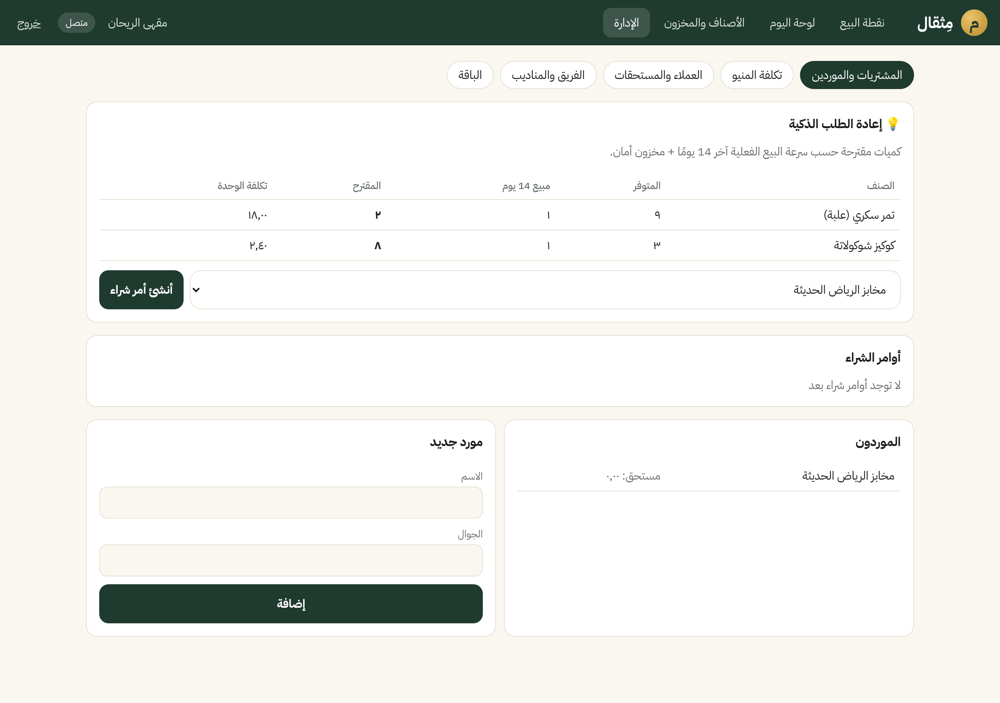
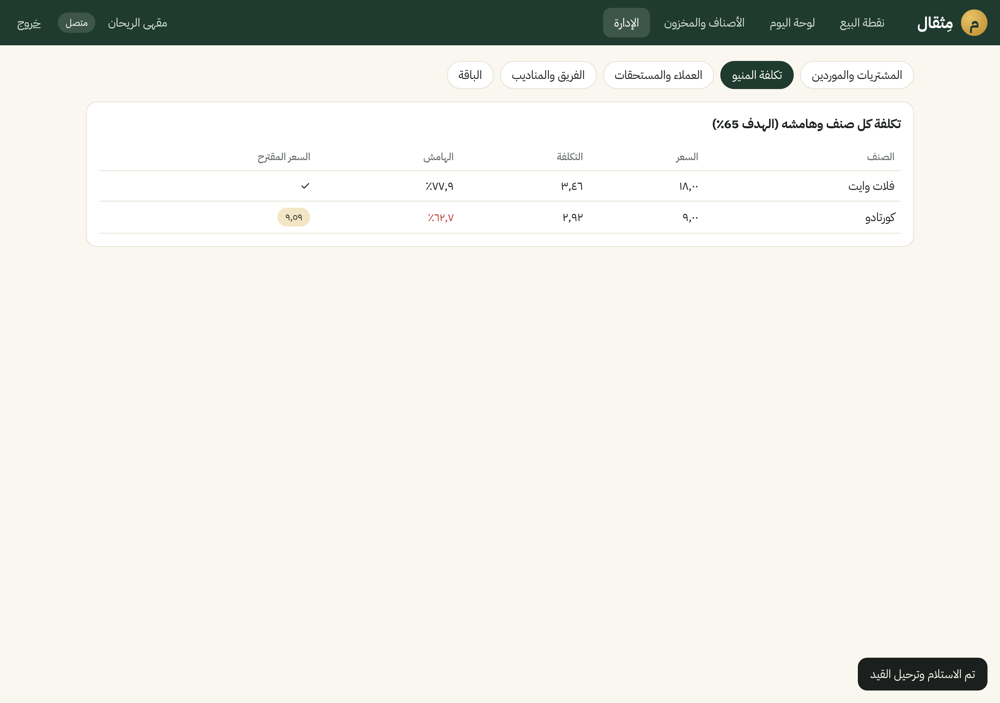
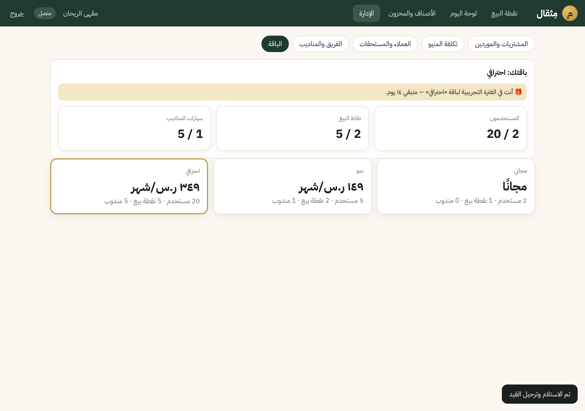
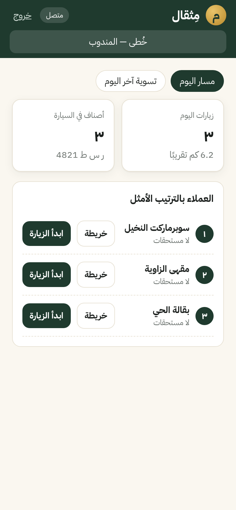
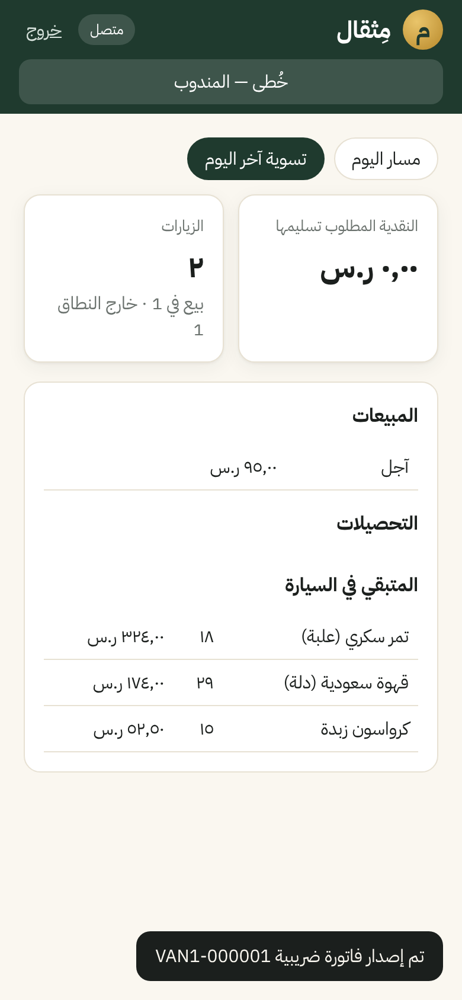
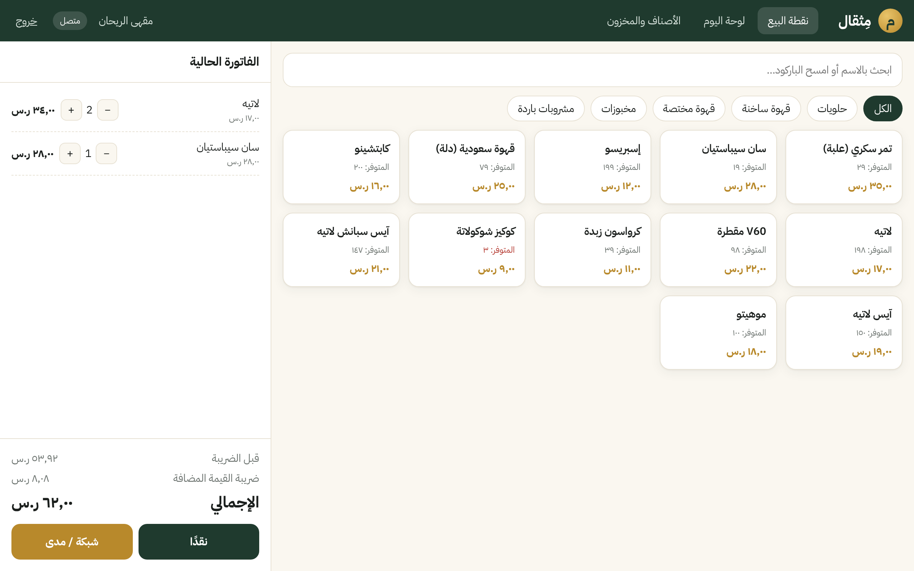
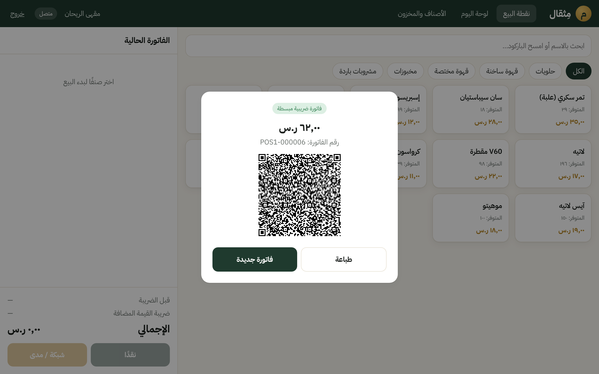
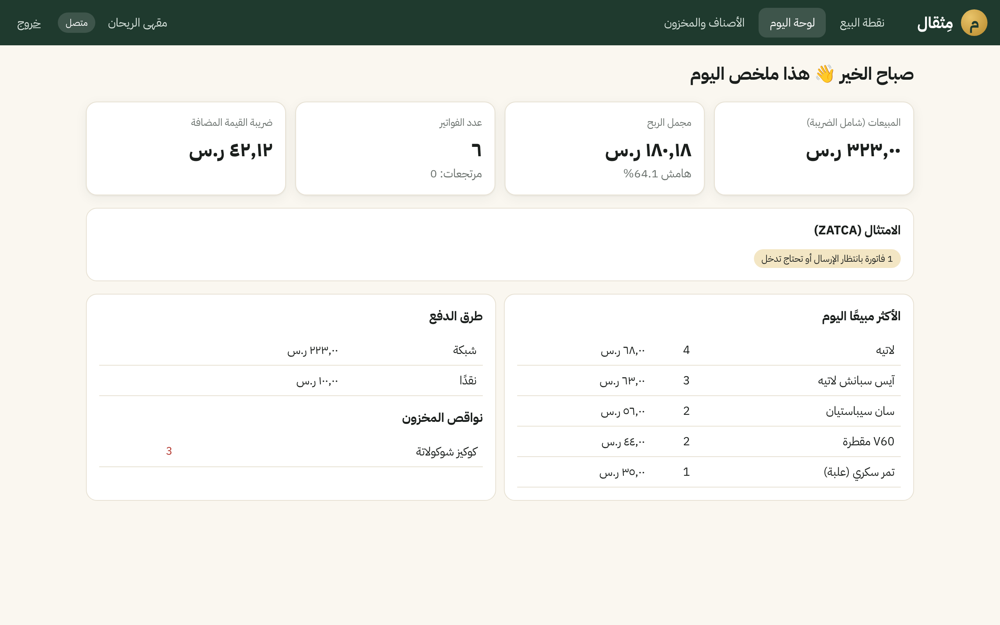

# مِثقال — Mithqal

**نظام تشغيل الأعمال الذكي للسعودية أولًا، ثم مصر والخليج والعالم.**
نقطة بيع، ومخزون، ومحاسبة بقيد مزدوج، وفوترة إلكترونية متوافقة مع ZATCA، ومناديب، ومساعد ذكي بالعربي. كله في منصة واحدة.

> «كل مثقال في شغلك… محسوب.»

| إعادة الطلب الذكية | تكلفة المنيو | الباقة |
|---|---|---|
|  |  |  |

| خُطى: مسار المندوب | زيارة وبيع من السيارة | تسوية آخر اليوم |
|---|---|---|
|  |  |  |

| نقطة البيع | إيصال ZATCA | لوحة المالك | الجوال |
|---|---|---|---|
|  |  |  |  |

---

## ما الذي يعمل الآن (MVP — السعودية)

| الموديول | الحالة | التفاصيل |
|---|---|---|
| تسجيل منشأة في دقيقة | ✅ | طلب واحد ينشئ: المنشأة، والفرع، والمستودع، ونقطة البيع بمفاتيح ZATCA، وشجرة الحسابات السعودية، والمالك |
| نقطة البيع (ويب، RTL) | ✅ | تصنيفات، ومسح باركود، وضريبة لحظية، ونقدي/شبكة، وإيصال بـ QR |
| العمل بدون إنترنت | ✅ | الفواتير تُحفظ على الجهاز وتُزامن تلقائيًا. الخادم يمنع التكرار عن طريق `clientUuid` |
| **مصر — Country Pack** | ✅ (يحتاج اعتماد رسمي) | جنيه مصري، وضريبة 14%، وإيصال إلكتروني ETA (تسلسل JSON، و UUID بـ SHA-256 متسلسل بـ previousUUID، وإيصالات بيع S ومرتجع R، ورابط QR للتحقق) |
| فوترة ZATCA المرحلة الثانية | ✅ (يحتاج اعتماد رسمي) | UBL 2.1، و QR (Tags 1–9)، وسلسلة ICV/PIH لكل جهاز، وتوقيع ECDSA secp256k1، وإبلاغ B2C واعتماد (Clearance) B2B، وإشعارات دائنة 381 |
| المحاسبة | ✅ | قيد مزدوج **مفروض من قاعدة البيانات**، ودفاتر غير قابلة للتعديل، وقيود يدوية للمحاسب (حسابات المخزون والعملاء والموردين بتتحرك من حركاتها بس)، وميزان مراجعة، وقائمة دخل، وميزانية عمومية، وكشف حساب برصيد متحرك، وإقرار ضريبة القيمة المضافة |
| المخزون | ✅ | متوسط مرجّح متحرك، وتشغيلات وصلاحية، وصرف **FEFO** (يمنع بيع المنتهي)، وتحويلات بين المستودعات |
| الموارد البشرية والرواتب | ✅ | موظفين، وتنبيهات انتهاء الإقامة والجواز والشهادة الصحية، ومسير رواتب شهري فيه تأمينات اجتماعية (نسب بتاريخ سريان في جدول إعدادات، ومش مكتوبة في الكود)، وقيد آلي، وملف تحويل الرواتب للبنك |
| المشتريات والموردين | ✅ | موردين، وأوامر شراء (أمين المخزن يعمل المسودة والمالك يعتمد)، واستلام جزئي يمنع الزيادة، ومستحقات الموردين وسدادها، و**إعادة طلب ذكية** حسب سرعة البيع الفعلية |
| شاشة التحضير (KDS) | ✅ | المشروبات والأطباق اللي بتتحضر بتظهر على شاشة المطبخ والباريستا بعدّاد وقت (أحمر بعد 5 دقائق)، وحالة «جاهز» ثم «تم التسليم»، وتقرير متوسط زمن التحضير |
| الكافيهات: الوصفات وتكلفة الكوب الحية | ✅ | بيع اللاتيه يخصم البن والحليب والكوب تلقائيًا، وتقرير هامش كل صنف مع **السعر المقترح** للوصول للهامش المستهدف |
| الصيدليات | ✅ (أساسي) | تشغيلات إلزامية، وأدوية بنسبة صفر، وتقرير قرب الانتهاء مع اقتراح الإجراء |
| **المناديب — مثقال خُطى** | ✅ | سيارة لكل مندوب، وزيارات بـ GPS وسياج جغرافي 200م، وحد ائتمان، وتحصيل، وتخطيط مسار تلقائي، وتسوية آخر اليوم |
| المساعد «ذهب» | ✅ v1 + v2 | v1: أسئلة بالعامية السعودية والمصرية تتجاوب من بياناتك الحقيقية من غير أي خدمة خارجية. v2 (اختياري): Claude (`claude-opus-5-5`) بأدوات **قراءة فقط** جوه نفس معاملة المستأجر، والأرقام بتيجي من الأدوات بس، ولو حصل رفض أو عطل بيرجع تلقائيًا لـ v1. بيتفعّل بـ `ANTHROPIC_API_KEY` |
| Fraud Guard | ✅ v1 | كشف أنماط الكاشير المريبة (مرتجعات كثيرة أو بعد البيع بدقائق) |
| الباقات والتراخيص | ✅ | مجاني، ونمو، واحترافي، ومؤسسات. كل منشأة جديدة تاخد تجربة «احترافي» 14 يوم، وبعدها الموديولات والحدود (مستخدمين، ونقاط بيع، وسيارات) تتقفل حسب الباقة، ومعاها لوحة المشغّل (عدد العملاء والإيراد الشهري MRR) |
| تعدد المستأجرين والأمان | ✅ | Row-Level Security في PostgreSQL، ودور تشغيل بدون صلاحيات مدير، وصلاحيات حسب الدور، وسجل تدقيق مسلسل بالـ Hash |

**الاختبارات: 142 اختبار ناجح** (money 10، و zatca 9، و eta 5، و domain 21، و API 97 على PostgreSQL حقيقي)، منها اختبارات تزامن (مرتجعات متوازية، وإعادة إرسال متوازية) واختبار يضمن إن حساب المخزون في الدفاتر يساوي قيمة المخزون الفعلية.

---

## التشغيل محليًا

المتطلبات: Node 22+، و pnpm 10، و PostgreSQL 16 (أو Docker).

```bash
# 1) قاعدة البيانات
docker compose up -d db          # أو PostgreSQL محلي فيه المستخدم mithqal/mithqal

# 2) التبعيات والبناء
pnpm install
pnpm -r --filter "./packages/*" build

# 3) الخادم (يطبّق الـ migrations تلقائيًا)
pnpm dev:api                     # http://localhost:4000

# 4) بيانات تجريبية (مقهى في الرياض)
pnpm --filter @mithqal/api seed:demo

# 5) الواجهة
pnpm dev:web                     # http://localhost:5173
# المالك: demo@mithqal.app / Mithqal#2026
# المندوب: rep@mithqal.app / Mithqal#2026 (افتحها من الجوال)
```

الاختبارات: `pnpm test`. اختبارات الـ API محتاجة قاعدة `mithqal_test` (اسمها بيتغير بـ `TEST_DB_NAME`).

---

## المعمارية

```
mithqal/
├── packages/
│   ├── money/     # أرقام عشرية دقيقة، وتقسيم الضريبة شامل/غير شامل، وتوزيع بدون فقد هللات
│   ├── zatca/     # TLV QR، و UBL 2.1، والـ Hash، وسلسلة الجهاز، وتوقيع ECDSA
│   ├── eta/       # مصر: تسلسل ETA القياسي، و UUID الإيصال، وإيصال البيع والمرتجع
│   └── domain/    # التسعير، وقواعد القيد، والتكلفة، و FEFO، وشجرة الحسابات، وتخطيط المسار
└── apps/
    ├── api/       # Fastify + PostgreSQL (RLS) — كل الموديولات
    └── web/       # React + Vite — نقطة البيع ولوحة المالك (RTL)
```

**مبادئ ثابتة (Invariants)** — كلها مفروضة من قاعدة البيانات أو مغطاة باختبارات:
1. كل قيد متوازن، والقاعدة ترفض قيد غير متوازن وقت الـ COMMIT.
2. الفواتير والقيود وحركات المخزون والتحصيلات وسجل التدقيق كلها **إضافة فقط**، والتصحيح يكون بمستند عكسي.
3. مستأجر ما يشوفش بيانات مستأجر تاني، حتى لو فيه خطأ في الكود (RLS).
4. إعادة إرسال نفس العملية من جهاز Offline ما تكررش الفاتورة.
5. سلسلة ICV/PIH لكل جهاز تتحدث في نفس الـ Transaction بتاعة الفاتورة.

قرارات المعمارية موثقة في [`docs/adr`](docs/adr). ودليل المستخدم بالعربي موجود في [`docs/user-guide`](docs/user-guide/دليل-المستخدم.md).

---

## API — أهم المسارات

| المسار | الوصف |
|---|---|
| `POST /v1/onboarding` | تسجيل منشأة جديدة (يرجّع Token) |
| `POST /v1/auth/login` | تسجيل الدخول |
| `POST /v1/users` | إضافة موظف: محاسب، أو كاشير، أو أمين مخزن، أو مندوب |
| `GET/POST /v1/items` | الأصناف |
| `GET/POST /v1/customers` | العملاء (مع الموقع وحد الائتمان والرصيد) |
| `POST /v1/inventory/receipts` | استلام بضاعة (مع قيد المخزون وضريبة المدخلات) |
| `GET/POST /v1/suppliers` · `POST /v1/suppliers/:id/payments` | الموردين ومستحقاتهم وسدادها |
| `POST /v1/hr/employees` · `POST /v1/hr/payroll` · `GET /v1/hr/payroll/:period/bank-file` · `GET /v1/hr/expiring-documents` | الموارد البشرية والرواتب |
| `GET /v1/purchasing/suggestions` | اقتراحات إعادة الطلب الذكية |
| `POST /v1/purchasing/orders` · `/:id/approve` · `/:id/receive` | دورة أمر الشراء |
| `POST /v1/inventory/transfers` | تحويل مخزون (مثلًا تحميل سيارة المندوب) |
| `POST /v1/pos/sales` | فاتورة بيع (B2C مبسطة أو B2B ضريبية تلقائيًا) |
| `POST /v1/pos/sales/:id/refund` | إرجاع كإشعار دائن |
| `POST /v1/van/assign` | تخصيص سيارة لمندوب |
| `GET /v1/van/route` | مسار اليوم المحسّن |
| `POST /v1/van/visits` · `/checkout` | تسجيل زيارة بالـ GPS |
| `POST /v1/collections` | تحصيل من عميل |
| `GET /v1/van/settlement` | تسوية المندوب آخر اليوم |
| `PUT /v1/items/:id/recipe` | وصفة صنف المنيو |
| `GET /v1/reports/daily · trial-balance · vat · expiring · menu-costing` | التقارير |
| `POST /v1/accounting/journals` | قيد يدوي |
| `GET /v1/reports/income-statement · balance-sheet · account/:code` | القوائم المالية وكشف الحساب |
| `POST /v1/assistant/ask` | سؤال «ذهب» |
| `GET /v1/insights/cashiers` | Fraud Guard |
| `GET /v1/einvoices` | حالة الفواتير الإلكترونية |
| `GET /v1/subscription` | الباقة والاستخدام والحدود |
| `GET /v1/platform/tenants` · `POST …/:id/plan` | لوحة المشغّل (بمفتاح `x-platform-key`) |
| `GET /v1/audit/verify` | التحقق من سلامة سجل التدقيق |

---

## المراجعة المستقلة

عملنا مراجعة كود مستقلة (صحة الأرقام والأمان). المراجعة **ما لقيتش أي تسريب بين المستأجرين**، ولقت 16 ملاحظة. كلها اتصلحت، وكل ملاحظة مؤكدة ليها اختبار يمنع رجوعها (`apps/api/test/hardening.test.ts`). أهمها:
- المرتجع المتوازي لنفس الفاتورة بقى مستحيل (قفل + فهرس فريد).
- الحساب الموقوف يقدر يقرأ بس، ومش يقدر يبيع.
- تعديل السعر للمالك بس، وخصم الموظفين ليه حد أقصى.
- قيد إعادة تقييم تلقائي لما المخزون يكون بالسالب، عشان الدفاتر تفضل مساوية للمخزون.
- استلام من غير مورد بيتسجل رصيد افتتاحي، وضريبة المدخلات بتتحسب حسب نسبة كل صنف.
- مرتجع فاتورة B2B بيطلع إشعار دائن B2B، ومرتجع البيع الآجل بيخصم من رصيد العميل.
- إرسال الفواتير الإلكترونية بيعيد المحاولة بمهلة متزايدة، ومش بيتخلى عن الفاتورة.
- الترقيم والعمليات المكررة محمية بأقفال، والأخطاء بترجع 422 بدل 500.
- التحقق من إن المستخدم لسه نشط مع كل طلب.
- رفض أي معرّف تابع لمنشأة تانية.
- المساعد مش بيحجز اتصال قاعدة البيانات وهو مستني رد الذكاء الاصطناعي.

## قائمة ما قبل الإنتاج (ZATCA)

النظام بيولّد كل عناصر المرحلة التانية، بس **قبل التشغيل الفعلي** لازم الخطوات دي:
- [ ] تشغيل كل نوع مستند على **ZATCA SDK** (`fatoora -validate`) وتصحيح أي ملاحظة.
- [ ] إضافة **XAdES SignedProperties** والتوقيع داخل `UBLExtensions` بالشكل المعتمد، وكمان C14N 1.1 الرسمي.
- [ ] **Onboarding** لكل جهاز: CSR، و OTP، و Compliance CSID، و Production CSID، مع تخزين المفاتيح في **KMS/HSM**. في وضع التطوير المفاتيح متخزنة في القاعدة.
- [ ] **CSID لكل جهاز**: عميل الإرسال حاليًا بيستخدم توكن عام من متغيرات البيئة، ولازم يتحول لـ CSID خاص بكل نقطة بيع.
- [ ] اختبارات المطابقة (Compliance checks) في بيئة Simulation.
- [ ] فاتورة B2B ما تتسلمش للمشتري قبل ما ترجع Cleared من ZATCA.

---

## الخطوات التالية (Roadmap)

1. **تطبيق المندوب الأصلي (React Native)**: نسخة الويب «خُطى» شغالة دلوقتي. الخطوة الجاية خريطة داخلية، وطباعة بلوتوث، و Offline كامل للزيارات.
2. حزمة الكافيهات المتقدمة: Modifiers، وشاشة المطبخ (KDS)، وطاولات.
3. الصيدليات: دليل أدوية وبدائل، وروشتات، وتأمين، وتكامل «رصد».
4. «ذهب»: قناة واتساب، وتوقع السيولة، وإجراءات مقترحة بموافقة المالك (أمر شراء أو تذكير تحصيل).
5. مصر: ربط الإرسال الفعلي لمنظومة الإيصال (OAuth لنقطة البيع)، والفاتورة الإلكترونية B2B بالتوقيع (USB Token / HSM).
6. الرواتب: الربط مع مُدد وصيغة WPS الرسمية، ومكافأة نهاية الخدمة، والإجازات والحضور. نظام التأمينات 2024 مطبق: المسجلين لأول مرة من 3 يوليو 2024 نسبة المعاشات عندهم 9.5% (2025)، وبعدين 10% (2026)، وبعدين 10.5% (2027)، وبعدين 11% (2028). والمسجلين قبل كده نسبتهم 9%. لسه لازم تتأكد من النسب على gosi.gov.sa قبل الإطلاق.
7. الاستضافة: Google Cloud الدمام (`me-central2`) بـ Terraform، ومنطقة لكل دولة.

---

## English summary

Mithqal is an AI-native, multi-tenant ERP and POS platform for Saudi Arabia first (then Egypt, the GCC and global).
The MVP ships these modules, tested end-to-end against real PostgreSQL:
- a ZATCA Phase 2-ready e-invoicing core
- an offline-first RTL POS
- a database-enforced double-entry ledger
- moving-average and FEFO inventory
- van sales with GPS geofencing, credit limits, collections and route planning
- an Arabic-dialect business assistant
- cashier fraud detection
